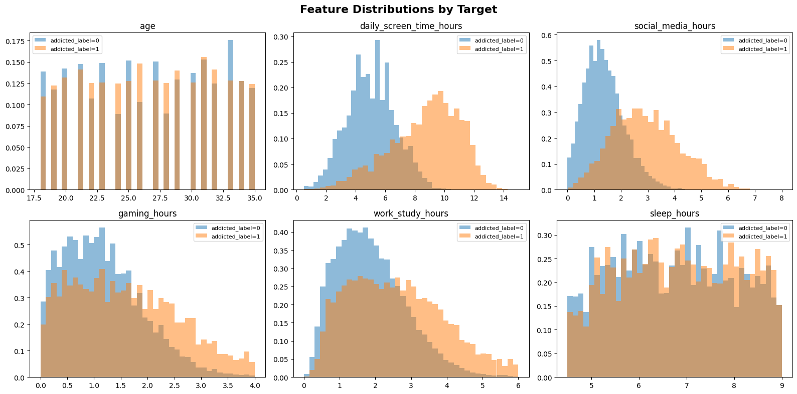
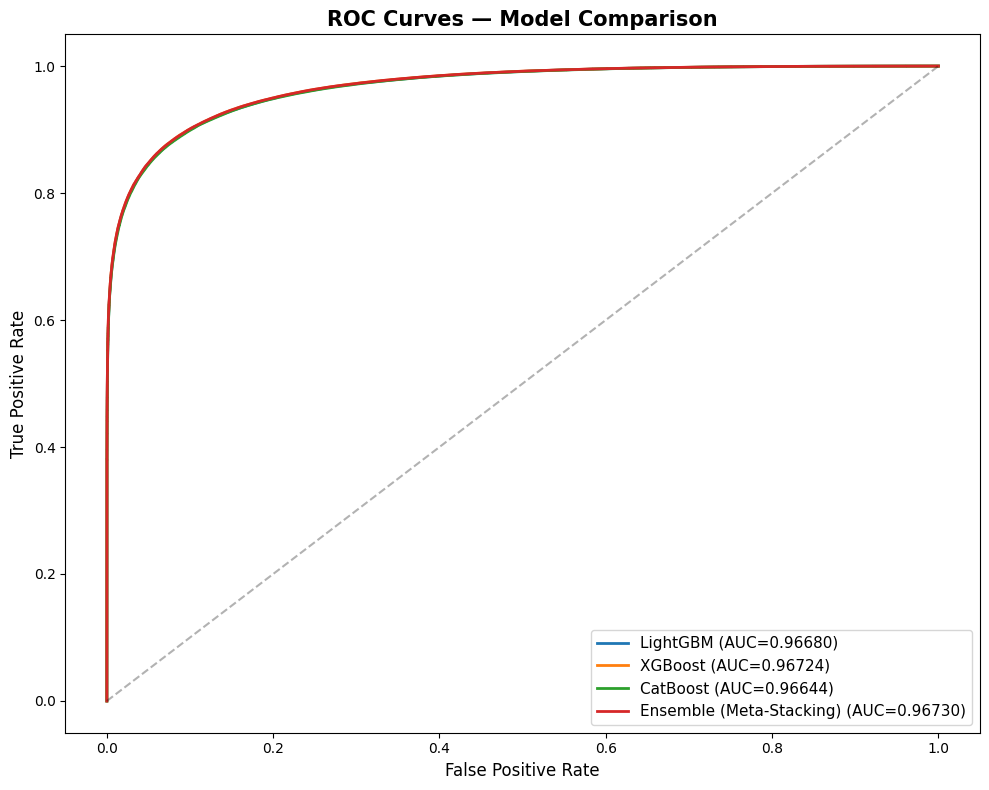

# 📱 Predicting Smartphone Addiction — Kaggle Playground S6E8

Binary classification with **LightGBM + XGBoost + CatBoost** and a **Logistic Regression meta-stack**, built around the "String Trick" for synthetic tabular data.

**Final 5-fold out-of-fold ROC-AUC: `0.9673`** (cross-validation score, not a leaderboard score).

## Problem
Predict the probability that a user is addicted to their smartphone (`addicted_label`) from 12 behavioural and demographic features. Metric: **ROC-AUC**. Data: [Kaggle Playground Series, Season 6 Episode 8](https://www.kaggle.com/competitions/playground-series-s6e8) (synthetic).

| | Rows | Columns |
|---|---|---|
| `train.csv` | 691,369 | 14 |
| `test.csv` | 296,302 | 13 |

Target balance: 70.94% addicted / 29.06% not addicted.

## Approach (the 7 steps of data science)
1. **Problem definition**: probability output, ROC-AUC metric.
2. **Data collection**: 9 numeric + 3 categorical features.
3. **Cleaning & EDA**: 4–19% missing values per feature, deliberately **not imputed** (tree models handle NaN natively); inf → NaN as a safety step.
4. **Feature engineering — the String Trick**: the synthetic data lives on a discrete grid, so each numeric column is converted to a string, treated as a category, and **5-fold OOF target-encoded** (test uses full-train means). Final feature set: 9 raw numeric + 3 label-encoded + 12 target-encoded = **24 features**.
5. **Model building**: 5-fold `StratifiedKFold` (seed 42), early stopping 100 rounds, learning rate 0.02, up to 5,000 trees.
6. **Evaluation & ensemble**: meta-stacking (3 OOF predictions + 3 pairwise products → Logistic Regression), with an AUC-weighted average as fallback; the better one is chosen automatically.
7. **Submission**: 296,302 rows, `id` + `addicted_label`, sanity checks asserted.

## Results (OOF ROC-AUC)
| Model | AUC | Runs on · time |
|---|---|---|
| LightGBM | 0.966796 | CPU · ~13.4 min |
| XGBoost | 0.967244 | GPU · ~2.1 min |
| CatBoost | 0.966438 | GPU · ~4.3 min |
| Weighted average | 0.967297 | – |
| **Meta-Stacking (selected)** | **0.967304** | – |

Fold-to-fold std is ~0.0004–0.0005. Total pipeline: ~20.6 min on a Kaggle T4 notebook.

> **Honest note:** stacking adds only ~+0.00006 AUC over the best single model (XGBoost). The notebook contains no ablation, so the String Trick's exact contribution is not measured here.




## Repository structure
```
├── notebooks/predicting-smartphone-addiction-s6e8.ipynb   # full pipeline with saved outputs
├── presentation/Predicting_Smartphone_Addiction_S6E8_Deck_Redesigned.pptx
├── assets/                                                # charts exported from the notebook
├── requirements.txt
├── LICENSE
└── README.md
```

## How to run
1. Download the competition data from Kaggle and place it in a folder.
2. Install dependencies: `pip install -r requirements.txt`
3. Open the notebook and set `INPUT_DIR` (default: `/kaggle/input/competitions/playground-series-s6e8`).
4. Run all cells. XGBoost and CatBoost use the GPU when `CFG.USE_GPU = True`; set it to `False` for CPU only.
5. Output: `submission.csv`.

Data is not included in this repository (Kaggle competition rules).

## Presentation
A 16-slide deck covering all 7 steps, with plain-English explanations next to each technique, lives in [`presentation/`](presentation/).

## License
MIT — see [LICENSE](LICENSE).
